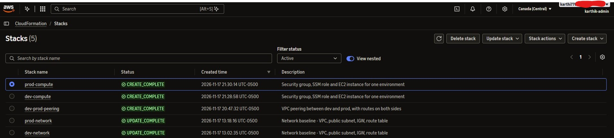
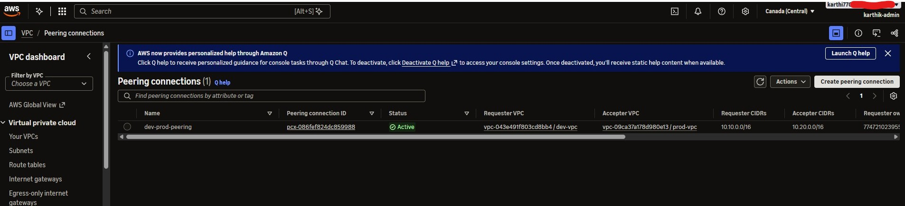
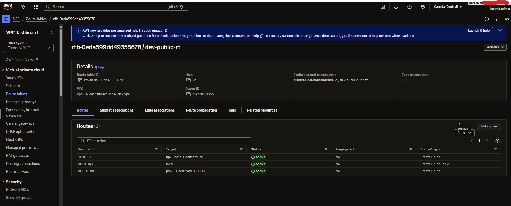
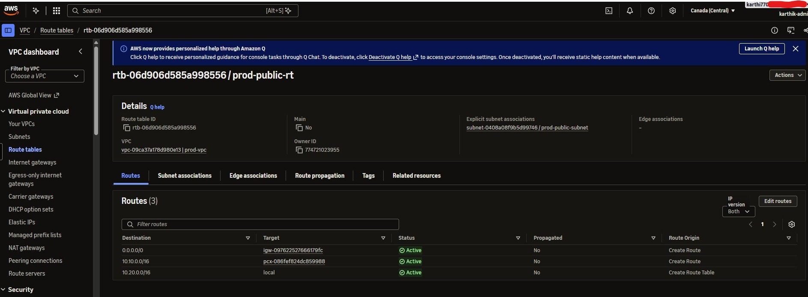
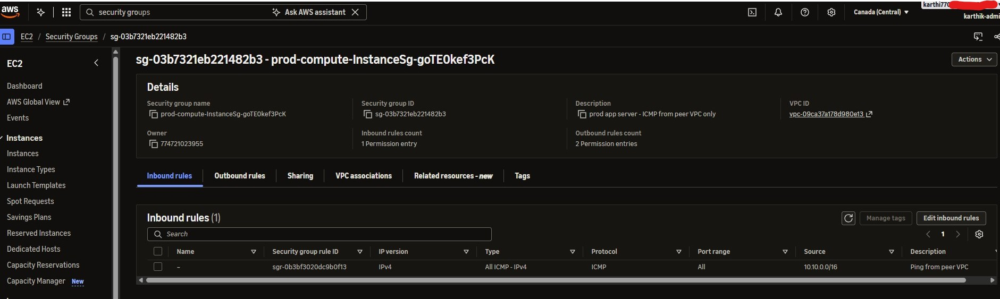
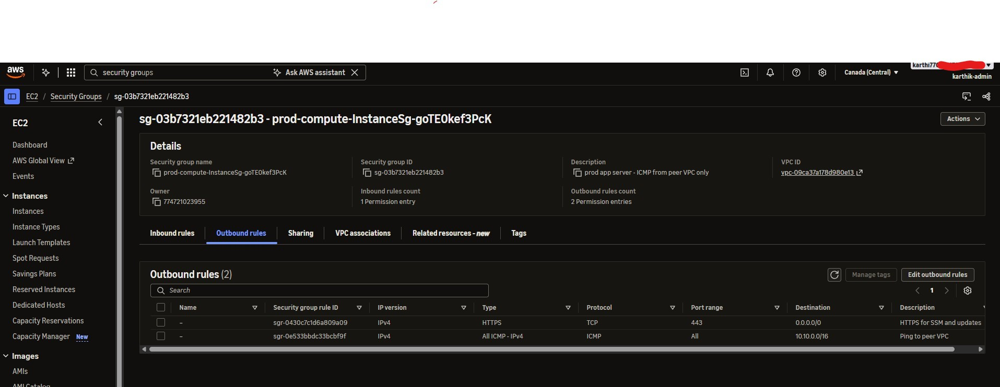
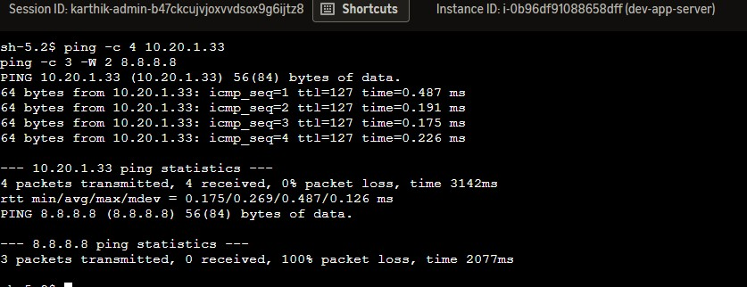
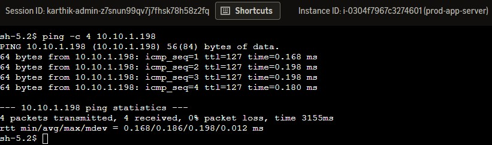

# Secure AWS Infrastructure & Operations

A CloudFormation-managed AWS environment built to practise **operating infrastructure securely**, not just deploying it. Two isolated environments (dev and prod) are created from the same templates, connected with VPC peering, and administered without SSH.

**Status:** in progress. Sections marked *Planned* are not built yet.

| | |
|---|---|
| **Region** | ca-central-1 (Canada Central) |
| **Tooling** | CloudFormation, AWS Console, Systems Manager Session Manager, Git |
| **Environments** | `dev` (10.10.0.0/16) and `prod` (10.20.0.0/16) |

---

## Architecture

```
                     ca-central-1
 ┌──────────────────────────────┐        ┌──────────────────────────────┐
 │ dev VPC  10.10.0.0/16        │        │ prod VPC  10.20.0.0/16       │
 │  public subnet 10.10.1.0/24  │◄──────►│  public subnet 10.20.1.0/24  │
 │  EC2 dev-app-server          │  VPC   │  EC2 prod-app-server         │
 │  IAM role (SSM) + SG (ICMP)  │ peering│  IAM role (SSM) + SG (ICMP)  │
 └──────────────┬───────────────┘        └──────────────┬───────────────┘
                │ Internet gateway                      │ Internet gateway
                └───────── Systems Manager (HTTPS 443, outbound only) ──┘
```

## What is built

- **Network baseline.** One parameterized template creates a VPC, public subnet, internet gateway, route table and default route. It is deployed twice (`dev-network`, `prod-network`) with different CIDRs, so dev and prod stay separate but identical in shape.
- **VPC peering.** `dev-prod-peering` connects the two VPCs and adds a route in **each** route table to the other VPC's CIDR. Peering does nothing without routes on both sides.
- **Compute.** One template, deployed per environment, creates a security group, an IAM role with the AWS-managed `AmazonSSMManagedInstanceCore` policy, an instance profile and a `t3.micro` Amazon Linux 2023 instance.
- **Cross-stack exports.** The network stacks export their VPC, subnet, route table and CIDR values. The peering and compute stacks import them with `Fn::ImportValue`, so no resource IDs are hardcoded.

## Security decisions

| Decision | Why |
|---|---|
| No inbound SSH (port 22 closed, no key pair) | There is no inbound attack surface. Access goes outbound from the instance to Systems Manager over HTTPS, authorized by IAM. |
| Session Manager for administration | No long-lived credentials or keys on the instance, and sessions are tied to an IAM identity. |
| Security group allows ICMP only from the peer VPC CIDR | Least privilege: just enough to prove connectivity. |
| Egress limited to HTTPS (443) and ICMP to the peer | The instance can reach Systems Manager but cannot ping or reach arbitrary internet hosts over ICMP. |
| IMDSv2 required (`HttpTokens: required`) | Blocks the older, easier-to-abuse metadata service. |
| Non-overlapping CIDRs | Required for VPC peering. |
| Changes reviewed as change sets | See what will change, and whether anything is replaced, before applying. |

## Evidence

All screenshots are from this lab, in `ca-central-1`.

### Stacks

Five stacks, deployed in dependency order: both network stacks, the peering stack, then both compute stacks.



### VPC peering is active



### Routes on both sides

The dev route table sends `10.20.0.0/16` to the peering connection, and the prod route table sends `10.10.0.0/16` to the same connection. Local traffic uses the `local` route and everything else uses the internet gateway.

| Dev route table | Prod route table |
|---|---|
|  |  |

### Instances

Both instances are running and passing 3/3 status checks.


### Security group (prod example)

Inbound allows only ICMP from the other VPC. Outbound allows HTTPS for Systems Manager and ICMP to the peer.

| Inbound | Outbound |
|---|---|
|  |  |

### Connectivity tests (via Session Manager)

| Test | Result |
|---|---|
| dev to prod (`10.20.1.33`) | 4/4 replies, 0% loss |
| prod to dev (`10.10.1.198`) | 4/4 replies, 0% loss |
| dev to `8.8.8.8` | 100% loss, as designed (egress allows no internet ICMP) |

| Dev instance | Prod instance |
|---|---|
|  |  |

An SSH attempt through EC2 Instance Connect is also refused, because port 22 is closed. Session Manager connects normally, which confirms access is IAM-based and not network-based.

## Issues encountered

| Issue | Cause | Resolution |
|---|---|---|
| CloudShell would not start | AWS account verification was still in progress on a new account | Switched to deploying templates from the CloudFormation console and editing locally in WSL with Git |
| `Template format error: YAML not well-formed (line 64, column 4)` | The shell heredoc terminator (`EOF`) was copied into the template file | Removed the stray line. The error position pointed straight at it |
| Console SSH connection failed | Expected: port 22 is closed by design | Used the Session Manager tab instead |

More detail is in [`docs/troubleshooting.md`](docs/troubleshooting.md).

## Deploying

Templates are in `cloudformation/`. Deploy in this order, using the CloudFormation console (**Create stack, Upload a template file**):

| Order | Stack | Template | Parameters |
|---|---|---|---|
| 1 | `dev-network` | `network.yaml` | `EnvName=dev`, `VpcCidr=10.10.0.0/16`, `PublicSubnetCidr=10.10.1.0/24` |
| 2 | `prod-network` | `network.yaml` | `EnvName=prod`, `VpcCidr=10.20.0.0/16`, `PublicSubnetCidr=10.20.1.0/24` |
| 3 | `dev-prod-peering` | `peering.yaml` | none |
| 4 | `dev-compute` | `compute.yaml` | `EnvName=dev`, `PeerCidr=10.20.0.0/16` |
| 5 | `prod-compute` | `compute.yaml` | `EnvName=prod`, `PeerCidr=10.10.0.0/16` |

The compute stacks create IAM resources, so the console asks you to acknowledge that.

## Cleanup

Exports that are in use cannot be changed or deleted, so remove stacks from the top of the dependency chain down:

1. `prod-compute` and `dev-compute`
2. `dev-prod-peering`
3. `dev-network` and `prod-network`

The two EC2 instances are the only resources that cost money by the hour. They are terminated after each session.

## Planned

- Encrypted, versioned S3 bucket with public access blocked
- Least-privilege IAM role scoped to one bucket prefix, with a tested AccessDenied outside it
- A demonstration secret in SSM Parameter Store (SecureString), retrieved through an authorized role
- CloudWatch alarm with SNS email notification
- Failure exercises with runbooks: configuration drift, failed stack update and rollback, access denied, and restore from backup

## Repository layout

```
cloudformation/   network.yaml, peering.yaml, compute.yaml
docs/             troubleshooting and runbooks
tests/            validation notes
screenshots/      evidence images used above
```

No secrets, keys, account IDs or state files are committed.
